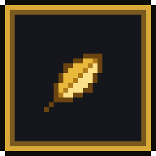
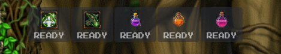
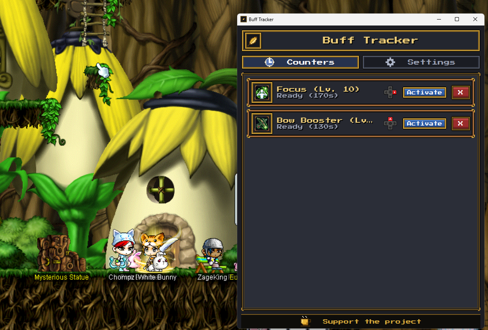
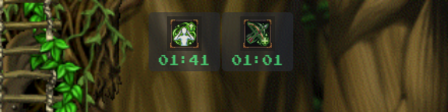
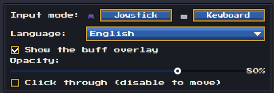

<div align="center">



# Buff Tracker

**A buff timer for MapleStory Classic that rings before your buffs run out.**
Press a button on your controller (or a key), the timer starts, and you get a sound when it's time to rebuff.

[](https://github.com/Mateuus-Goveia/buff-tracker/releases/latest)
[](https://github.com/Mateuus-Goveia/buff-tracker/releases)
[](LICENSE)


**[⬇ Download](https://github.com/Mateuus-Goveia/buff-tracker/releases/latest)** ·
**[How to install](#how-to-install)** ·
**[Quick start](#quick-start)** ·
**[Português (Brasil)](README.pt-BR.md)**



</div>

> **This is a beta.** It works, but it is young. Back up your `buffs.json` and `settings.json` before updating, and please [report anything odd](https://github.com/Mateuus-Goveia/buff-tracker/issues).

---

## What it does

You set up your buffs once (class, job, skill, level). From then on, one press starts that buff's timer, and a few seconds before it ends you hear a sound. No more checking the buff bar in the middle of a fight.

<div align="center">
  
</div>

- 🎮 **Controller or keyboard.** Map each buff to a D-Pad direction, a face button, or an `L2` / `R2` combo. Prefer the keyboard? Switch the input mode in Settings.
- ⏱️ **Accurate timers** for every first and second job buff, using each skill's level to get the right duration.
- 🔔 **22 reminder sounds**, with a preview when you pick one.
- 🧪 **Item buffs.** Three slots for the potion buffs (Attack, Accuracy, Speed), because the game only lets three item buffs run at once.
- 🪟 **Optional overlay.** A translucent, always-on-top strip over the game, with adjustable opacity and a click-through mode.
- 🌍 **English and Portuguese** interface. Switch any time with the language button.
- 🔒 **Private.** No accounts, no tracking, no data leaves your computer. See [Privacy](#privacy-and-safety).

## How to install

1. Download **`Controle-de-Buffs-Windows.zip`** from the [latest release](https://github.com/Mateuus-Goveia/buff-tracker/releases/latest).
2. **Extract the whole ZIP** to a folder you like (don't run it from inside the ZIP).
3. Open **`Controle de Buffs.lnk`**.

You don't need Python or anything else installed.

> ⚠️ **Windows may warn you the first time.** If SmartScreen says "Windows protected your PC", click **More info → Run anyway**. Early beta builds are not code-signed. The source code is right here if you want to check it or build it yourself.

## Quick start

1. Open the **Settings** tab and choose your **Input mode** (Joystick or Keyboard).
2. Pick your **Class**. The **first job** buffs are unlocked automatically.
3. Pick your **Job** (second job) to unlock its buffs, then choose the **Skill** and its **Level**.
4. Choose a **Shortcut** (a button, or a modifier + button) and an alert **Sound**.
5. Click **Add Skill / Shortcut to Preset**. Repeat for each buff.
6. Tick your potions under **Preset Consumables** and click **Save Settings**.
7. Play! Press the shortcut when you buff. The timer starts, and you hear the sound shortly before it ends.

You can also click **Activate** on any card in the **Counters** tab.

## The overlay

Turn on **Show the buff overlay** in Settings to get a small translucent strip over the game.

- **Opacity** slider: make it as subtle as you want.
- **Click through**: on by default, so the mouse goes straight to the game. Turn it off to drag the overlay somewhere else, then turn it on again.
- The game must run in **windowed** or **borderless** mode. Windows can't draw an overlay over exclusive fullscreen.

<div align="center">
  
  <br><br>
  
</div>

## Input modes

| Mode | How it works |
|------|--------------|
| **Joystick** | D-Pad directions and `A` / `B` / `X` / `Y`, alone or combined with `L2` / `R2`. Each shortcut starts one buff. |
| **Keyboard** | Each key starts at most one buff. `Ctrl`, `Alt` and `Shift` are treated like any other key. Buff Tracker only listens: it never blocks or changes your keystrokes. |

## Something not working?

| Problem | Try this |
|---------|----------|
| The overlay doesn't show up | Run the game in windowed or borderless mode, and make sure **Show the buff overlay** is on. |
| I can't click the overlay | That's **Click through**. Turn it off in Settings to move it, then turn it back on. |
| My controller isn't detected | Plug it in before opening Buff Tracker, and check that Windows sees it. Then restart the app. |
| Keyboard shortcuts don't react while playing | If the game runs as administrator, run Buff Tracker as administrator too. Windows doesn't let a normal app listen to an elevated one. |
| A shortcut is missing from the list | Each shortcut can be used by one buff only. Pick another, or remove the buff that uses it. |
| No sound | Check your Windows volume and try another sound in Settings. Picking a sound plays a preview. |

Still stuck? [Open an issue](https://github.com/Mateuus-Goveia/buff-tracker/issues) and tell me what you were doing. Screenshots help a lot.

## Privacy and safety

- Buff Tracker is an **independent fan tool**. It is not affiliated with, endorsed by or sponsored by Nexon.
- It **does not read, modify or interact with the game**. It only counts down timers that you start.
- **Nothing leaves your computer.** No usage data and no keystrokes are sent anywhere. The only network request is the optional **Check for updates** button, which contacts GitHub when you click it.
- Your presets and settings are saved locally in `buffs.json` and `settings.json`, next to the app.

## Updates

Click **Check for updates** in Settings. It opens the [Releases](https://github.com/Mateuus-Goveia/buff-tracker/releases) page so you can download the new version yourself. Nothing is installed automatically.

## Support the project

Buff Tracker is free and open source. If it saves you a few missed buffs and you'd like to say thanks, the **Support the project** button in the app has the options (PayPal and Pix). Starring the repo, sharing it, and reporting bugs help just as much. 💛

## Contributing

Contributions are welcome, from bug reports to translations and new features. Please read [CONTRIBUTING.md](CONTRIBUTING.md) and the [Code of Conduct](CODE_OF_CONDUCT.md) first. Questions go to [SUPPORT.md](SUPPORT.md).

## For developers

**Run from source** (Windows, Python 3.12 to 3.14):

```powershell
git clone https://github.com/Mateuus-Goveia/buff-tracker.git
cd buff-tracker
python -m venv venv
venv\Scripts\activate
pip install -r requirements.txt
python main_desktop.py
```

**Run the tests:**

```powershell
pip install -r requirements-dev.txt
pytest
```

**Build the Windows package:**

```powershell
.\tools\build_windows.ps1
```

The output goes to `dist/Controle de Buffs/` and `dist/Controle-de-Buffs-Windows.zip`.

**How it's built.** The interface is PySide6 (Qt), styled with a QSS theme and 9-slice sprites in `assets/ui/theme/`. Controller input uses pygame. Skills and consumables live in `data/*.json`, so adding a class or a buff doesn't need code changes. UI texts are in `assets/lang/*.json`; adding a language means adding one file.

## Credits

- Icons and art assets: see [ASSET_CREDITS.md](ASSET_CREDITS.md). MapleStory and its related names and images are property of Nexon.
- Font: [Press Start 2P](https://fonts.google.com/specimen/Press+Start+2P), under the SIL Open Font License 1.1.
- Built by [Matheus Ferreira Goveia](https://github.com/Mateuus-Goveia) · [LinkedIn](https://www.linkedin.com/in/matheus-goveia/) · bufftracker.contato@gmail.com

## License

The code and project data are released under the [MIT License](LICENSE).
