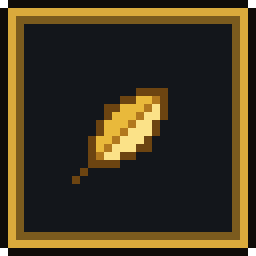
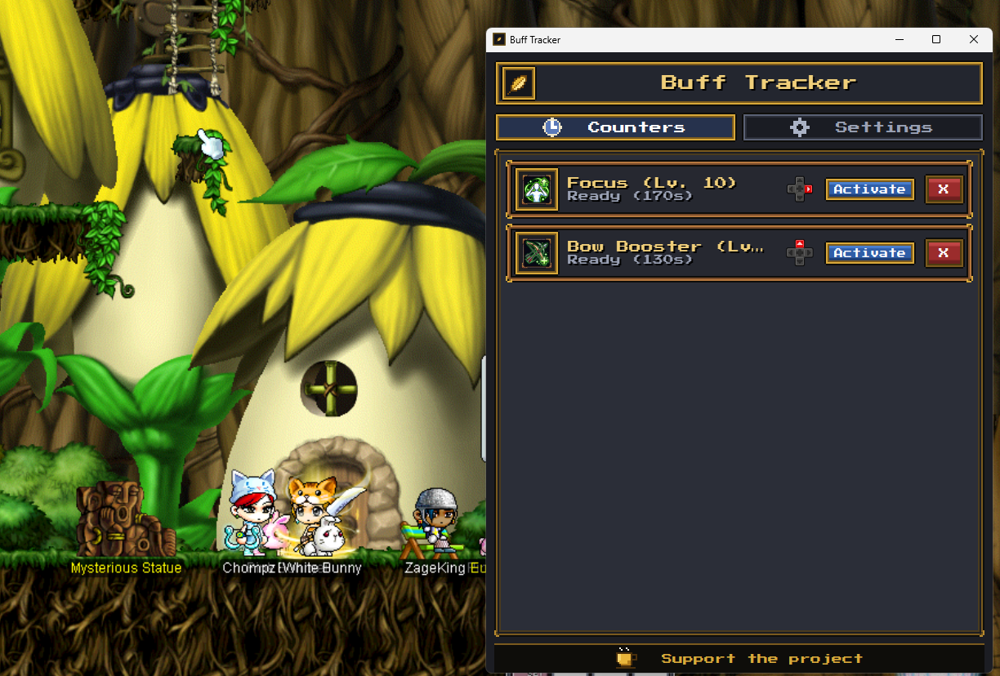
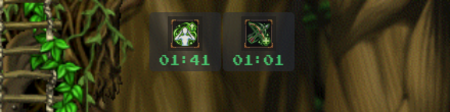
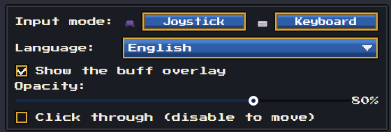

<div align="center">



# Buff Tracker

**Um timer de buffs para MapleStory Classic que toca antes de os seus buffs acabarem.**
Aperte um botão do controle (ou uma tecla), o timer começa e você ouve um som na hora de rebuffar.

[](https://github.com/Mateuus-Goveia/buff-tracker/releases/latest)
[](https://github.com/Mateuus-Goveia/buff-tracker/releases)
[](LICENSE)


**[⬇ Baixar](https://github.com/Mateuus-Goveia/buff-tracker/releases/latest)** ·
**[Como instalar](#como-instalar)** ·
**[Primeiros passos](#primeiros-passos)** ·
**[English](README.md)**


</div>

> **Isto é um beta.** Funciona, mas ainda é novo. Faça backup do `buffs.json` e do `settings.json` antes de atualizar e [avise se algo estranho acontecer](https://github.com/Mateuus-Goveia/buff-tracker/issues).

---

## O que ele faz

Você configura seus buffs uma vez (classe, job, skill e nível). Depois disso, um aperto inicia o timer daquele buff, e alguns segundos antes de acabar você ouve um som. Chega de ficar olhando a barra de buffs no meio da luta.

<div align="center">
  
</div>

- 🎮 **Controle ou teclado.** Associe cada buff a uma direção do D-Pad, a um botão ou a um combo com `L2` / `R2`. Prefere teclado? Troque o modo de entrada nas Configurações.
- ⏱️ **Timers precisos** para todos os buffs da 1ª e da 2ª job, usando o nível de cada skill para achar a duração certa.
- 🔔 **22 sons de lembrete**, com prévia ao escolher.
- 🧪 **Buffs de item.** Três espaços para as poções (Ataque, Accuracy e Speed), porque o jogo só deixa três buffs de item ativos ao mesmo tempo.
- 🪟 **Overlay opcional.** Uma faixa translúcida sempre no topo, por cima do jogo, com opacidade ajustável e modo "clique atravessa".
- 🌍 Interface em **inglês e português**. Troque quando quiser pelo botão de idioma.
- 🔒 **Privado.** Sem conta, sem rastreamento, nenhum dado sai do seu computador. Veja [Privacidade](#privacidade-e-segurança).

## Como instalar

1. Baixe o **`Controle-de-Buffs-Windows.zip`** na [última versão](https://github.com/Mateuus-Goveia/buff-tracker/releases/latest).
2. **Extraia o ZIP inteiro** numa pasta de sua escolha (não execute de dentro do ZIP).
3. Abra o **`Controle de Buffs.lnk`**.

Não precisa ter Python nem mais nada instalado.

> ⚠️ **O Windows pode avisar na primeira vez.** Se o SmartScreen disser "O Windows protegeu seu computador", clique em **Mais informações → Executar assim mesmo**. As versões beta ainda não têm assinatura de código. O código-fonte está aqui para você conferir ou compilar por conta própria.

## Primeiros passos

1. Abra a aba **Settings / Configurações** e escolha o **Input mode / Modo de entrada** (Joystick ou Keyboard).
2. Escolha a **Classe**. Os buffs da **1ª job** já ficam liberados automaticamente.
3. Escolha a **Job** (2ª job) para liberar os buffs dela, depois a **Skill** e o **Nível**.
4. Escolha um **Atalho** (um botão, ou modificador + botão) e um **Som** de alerta.
5. Clique em **Add Skill / Shortcut to Preset** (Adicionar Skill ao Preset). Repita para cada buff.
6. Marque suas poções em **Consumíveis do Preset** e clique em **Salvar Configurações**.
7. Jogue! Aperte o atalho quando buffar. O timer começa e você ouve o som pouco antes de acabar.

Você também pode clicar em **Ativar** em qualquer card da aba **Contadores**.

## O overlay

Ative **Show the buff overlay** (Mostrar o overlay) nas Configurações para ter uma faixa translúcida por cima do jogo.

- **Opacidade**: deixe tão discreto quanto quiser.
- **Clique atravessa**: ligado por padrão, para o mouse ir direto ao jogo. Desligue para arrastar o overlay para outro lugar e ligue de novo depois.
- O jogo precisa estar em modo **janela** ou **janela sem borda**. O Windows não desenha overlay sobre tela cheia exclusiva.

<div align="center">
  
  <br><br>
  
</div>

## Modos de entrada

| Modo | Como funciona |
|------|---------------|
| **Joystick** | Direções do D-Pad e `A` / `B` / `X` / `Y`, sozinhos ou combinados com `L2` / `R2`. Cada atalho inicia um buff. |
| **Teclado** | Cada tecla inicia no máximo um buff. `Ctrl`, `Alt` e `Shift` são tratados como qualquer outra tecla. O Buff Tracker só escuta: nunca bloqueia nem altera o que você digita. |

## Algo não funcionou?

| Problema | O que tentar |
|----------|--------------|
| O overlay não aparece | Rode o jogo em modo janela ou janela sem borda e confira se **Show the buff overlay** está ligado. |
| Não consigo clicar no overlay | É o **Clique atravessa**. Desligue nas Configurações para mover e ligue de novo. |
| Meu controle não é detectado | Conecte antes de abrir o Buff Tracker e confira se o Windows enxerga o controle. Depois reinicie o app. |
| Os atalhos do teclado não reagem durante o jogo | Se o jogo roda como administrador, rode o Buff Tracker como administrador também. O Windows não deixa um app normal escutar um app elevado. |
| Um atalho sumiu da lista | Cada atalho só pode ser de um buff. Escolha outro ou remova o buff que o usa. |
| Sem som | Confira o volume do Windows e teste outro som nas Configurações. Ao escolher um som, a prévia toca. |

Ainda travado? [Abra uma issue](https://github.com/Mateuus-Goveia/buff-tracker/issues) contando o que você estava fazendo. Prints ajudam muito.

## Privacidade e segurança

- O Buff Tracker é uma **ferramenta independente feita por fã**. Não é afiliado, endossado nem patrocinado pela Nexon.
- Ele **não lê, não modifica e não interage com o jogo**. Só conta os timers que você inicia.
- **Nada sai do seu computador.** Nenhum dado de uso nem tecla digitada é enviado. A única requisição de rede é o botão opcional **Check for updates**, que consulta o GitHub quando você clica.
- Seus presets e configurações ficam salvos localmente em `buffs.json` e `settings.json`, ao lado do app.

## Atualizações

Clique em **Check for updates** nas Configurações. Ele abre a página de [Releases](https://github.com/Mateuus-Goveia/buff-tracker/releases) para você baixar a nova versão. Nada é instalado automaticamente.

## Apoie o projeto

O Buff Tracker é gratuito e de código aberto. Se ele te poupou alguns buffs perdidos e você quiser agradecer, o botão **Apoie o projeto** dentro do app tem as opções (PayPal e Pix). Dar uma estrela no repositório, compartilhar e reportar bugs ajudam igualmente. 💛

## Contribuindo

Contribuições são bem-vindas, de relatos de bug a traduções e novas funções. Leia antes o [CONTRIBUTING.md](CONTRIBUTING.md) e o [Código de Conduta](CODE_OF_CONDUCT.md). Dúvidas vão para o [SUPPORT.md](SUPPORT.md).

## Para desenvolvedores

**Rodar a partir do código** (Windows, Python 3.12 a 3.14):

```powershell
git clone https://github.com/Mateuus-Goveia/buff-tracker.git
cd buff-tracker
python -m venv venv
venv\Scripts\activate
pip install -r requirements.txt
python main_desktop.py
```

**Rodar os testes:**

```powershell
pip install -r requirements-dev.txt
pytest
```

**Gerar o pacote para Windows:**

```powershell
.\tools\build_windows.ps1
```

A saída vai para `dist/Controle de Buffs/` e `dist/Controle-de-Buffs-Windows.zip`.

**Como é feito.** A interface é PySide6 (Qt), estilizada com um tema QSS e sprites 9-slice em `assets/ui/theme/`. O controle usa pygame. Skills e consumíveis ficam em `data/*.json`, então adicionar uma classe ou um buff não exige mexer no código. Os textos da interface ficam em `assets/lang/*.json`; adicionar um idioma é adicionar um arquivo.

## Créditos

- Ícones e artes: veja o [ASSET_CREDITS.md](ASSET_CREDITS.md). MapleStory e os nomes e imagens relacionados são propriedade da Nexon.
- Fonte: [Press Start 2P](https://fonts.google.com/specimen/Press+Start+2P), sob a SIL Open Font License 1.1.
- Feito por [Matheus Ferreira Goveia](https://github.com/Mateuus-Goveia) · [LinkedIn](https://www.linkedin.com/in/matheus-goveia/) · bufftracker.contato@gmail.com

## Licença

O código e os dados do projeto são liberados sob a [Licença MIT](LICENSE).
